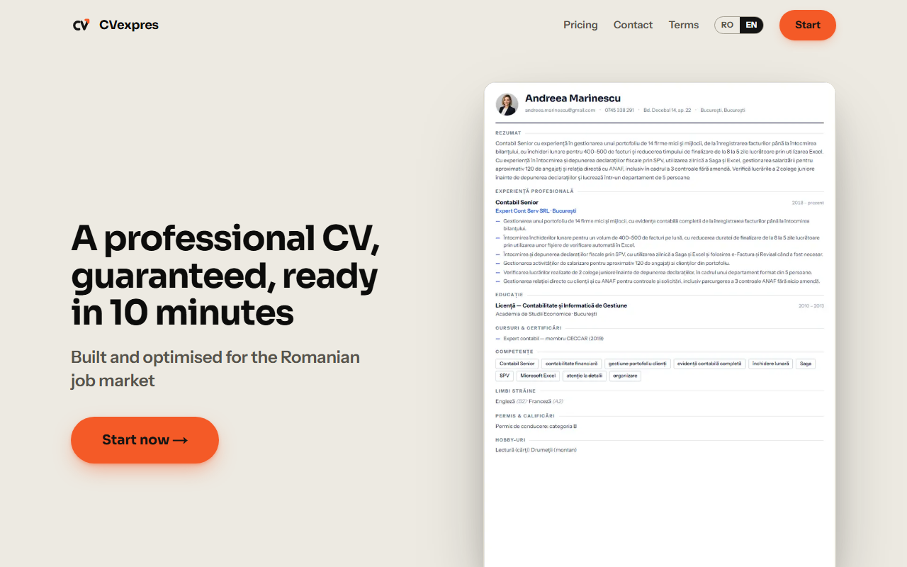
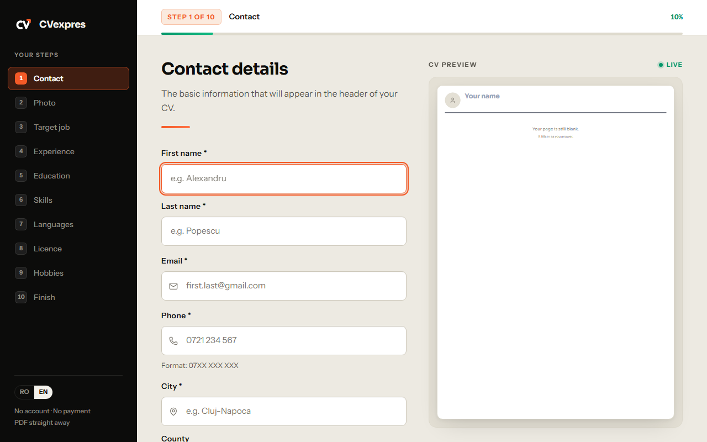
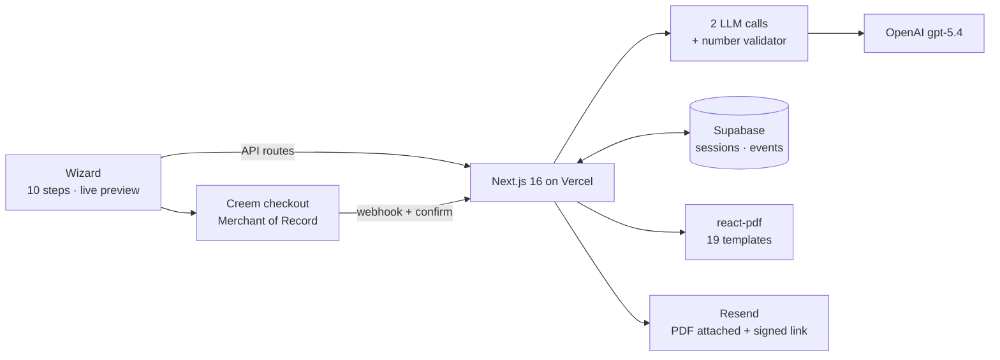
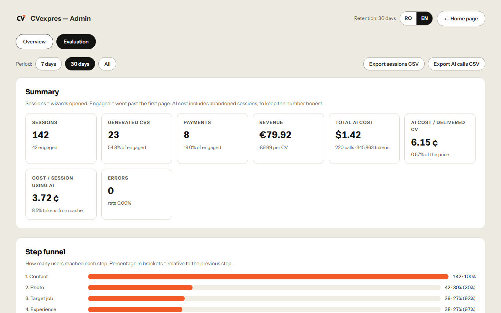

# CVexpres

[](https://github.com/Sasha5122/cvexpres/actions/workflows/ci.yml)
[](https://www.cvexpres.ro/en)
[](https://www.cvexpres.ro/demo/admin?lang=en)

An AI-powered CV builder for the Romanian job market. A live, paid product: the AI interviews the candidate like a recruiter would, writes the CV, a deterministic validator checks every figure against what the candidate actually said, and the result ships as a PDF in 19 designs.

- **Live:** [cvexpres.ro](https://www.cvexpres.ro) (Romanian) · [cvexpres.ro/en](https://www.cvexpres.ro/en) (English, demo level)
- **Operational dashboard with generated data:** [cvexpres.ro/demo/admin](https://www.cvexpres.ro/demo/admin?lang=en)
- **Docs:** [architecture](docs/architecture.md) · [model evaluation](docs/evaluation.md) · [engineering decisions](docs/decisions.md) · [incidents](docs/incidents.md)
- Romanian summary: [README.ro.md](README.ro.md)



## What it does

Most people applying for non-IT jobs in Romania write CVs that list duties, not results. CVexpres asks the candidate for a plain-language description of a job, has an LLM generate the five questions a recruiter would ask, and then writes seven CV bullets from the answers. Every number in those bullets must exist in the candidate's own words, or the bullet is regenerated and, failing that, dropped. The candidate edits, picks a template, pays once (49 lei ≈ €9.99) and receives the PDF by email with a 30-day re-download link.



## Architecture



One Next.js app, no separate backend. Details, sequence diagrams and the data model: [docs/architecture.md](docs/architecture.md).

**Stack.** Next.js 16 (App Router), React 19, TypeScript, Tailwind 4, Supabase (Postgres), OpenAI (Structured Outputs), `@react-pdf/renderer`, `sharp`, Creem, Resend, Upstash Redis, Vercel, Playwright.

## The AI pipeline

1. **The recruiter's eyes.** `rawText` (+ optional job ad) → exactly 5 recruiter questions. Structured Outputs with `strict: true`, one retry on invalid JSON, automatic retry without `reasoning_effort` when the API rejects it.
2. **The CV writer.** Raw text + Q&A → exactly 7 bullets in nominal form ("Gestionarea…", or "Managing…" in English). Prompt rules: only this job, one-off achievements phrased as "activity + including + the concrete case", job-ad vocabulary when the experience supports it.
3. **The validator (code, not AI).** Every `\d+(?:[.,]\d+)?` in a bullet must appear in the source. Equivalences: separators, Romanian word multipliers ("38 de mii" → 38000), English forms ("38k", "1.5 million", "1,200"), alphanumeric tokens like D112 or B2B. Invalid bullets get one targeted regeneration; still invalid → dropped; fewer than 5 left → 422 with a retry.

Secondary calls: job research cached per role for 30 days, skills (no fallback by design: a generic dictionary would be worse than an error), summary (best-effort), text correction on a nano model with length safety nets.

## Model evaluation

Nine model configurations were run on four synthetic cases and read blind. gpt-5.4 on both calls gave the same quality at a third of the cost of gpt-5.5, and is the production configuration.

| Config | Models (call 1 / call 2) | Cost / job | % of baseline | Numbers failed / dropped | JSON retries |
|---|---|---|---|---|---|
| C0 | gpt-5.5 / gpt-5.5 | 6.47 ¢ | 100% | 2 / 0 | 0 |
| **C2 (production)** | gpt-5.4 / gpt-5.4 | **2.14 ¢** | **33%** | 3 / 0 | 0 |
| C3 | gpt-5.4-mini / gpt-5.4 | 1.38 ¢ | 21% | 1 / 0 | 0 |
| C4 | gpt-5.4-mini / gpt-5.4-mini | 0.57 ¢ | 9% | 1 / 1 | 0 |
| C7 | gpt-5.4-nano / gpt-5.4 | 1.30 ¢ | 20% | 2 / 0 | 0 |

The surprise: one configuration was supposed to test `reasoning_effort: minimal`, but the API rejected the parameter on every case and the run silently became a copy of the baseline. It was only caught because the rejection is logged per call. Full method, all nine rows, raw outputs and limitations: [docs/evaluation.md](docs/evaluation.md).

## Observability



The admin dashboard is anonymised on the server (the API never returns names or emails, only `User #xxxxxx`) and shows, per session, AI cost, calls, tokens, AI time, time in the wizard and the number of valid bullets; and, aggregated, the step funnel, cost and p50/p95 latency per AI stage, validation quality, errors per route and the model benchmark. Telemetry is three event types written to the existing `events` table: `ai_call`, `api_error`, `validation_result`. The same dashboard runs publicly on a deterministic generated dataset at [/demo/admin](https://www.cvexpres.ro/demo/admin?lang=en).

## Engineering decisions worth knowing

- **Merchant of Record (Creem)** instead of a payment gateway: EU VAT and invoicing handled, launchable without a company; RON unsupported, so the price is charged in EUR.
- **Payments are a ledger** of `payment_completed` events; a read error throws instead of returning "not paid", because a "don't know" treated as "no" would send duplicate emails.
- **Two-layer idempotent delivery**: `cv_email_sent` plus a fresh `cv_email_claim` written before the heavy work, so a webhook and a browser confirm arriving in the same second cannot both send.
- **HMAC download token**, three fields, no JWT.
- **Local fonts bundled explicitly** after Google Fonts subsets expired in production.
- **Photos decoded to Buffers** because `react-pdf` fails silently on data-URIs.
- **Face-aware square crop with `sharp` and skin-tone heuristics**, no ML model, cold-start friendly.
- **Rate limiting fails open**: a Redis outage must not take the product down.
- **The app tolerates un-run migrations**: writes fall back to `events`, so deploys never wait on a manual SQL step.
- **30-day retention** as a product promise, enforced by a daily cron.
- **Cookie-based language**, Romanian default, no URL prefix: Romanian SEO untouched, one switch component.

All fifteen, with trade-offs: [docs/decisions.md](docs/decisions.md). What broke and what changed: [docs/incidents.md](docs/incidents.md).

## Testing

- **End-to-end (Playwright):** 55 tests on desktop Chromium, plus a Pixel 5 project. AI routes are mocked (`page.route`) so the suite is deterministic and free. Covers the landing, the whole wizard, persistence after refresh, the experience pipeline UI, the admin dashboard, anonymisation, language switching and delivery edge cases.
- **Real pipeline runs:** `pnpm test:pipeline --case=N` (Romanian cases 1–4, English case 5) and the model matrix script, against the real API.
- **PDF regression:** `scripts/test-blank-pages.mjs` grows the content on every template and flags trailing blank pages with pdfjs.
- **CI:** typecheck, lint and production build on every push and pull request.

## Run locally

```bash
git clone https://github.com/Sasha5122/cvexpres.git
cd cvexpres
pnpm install
cp .env.example .env.local   # fill in OpenAI, Supabase, Resend; payments optional
pnpm dev                     # http://localhost:3000
pnpm typecheck && pnpm lint
npx playwright test --project=chromium --workers=1
```

Supabase schema: `supabase-schema.sql` plus the optional migrations. Without `ADMIN_PASSWORD` the admin is disabled; without payment variables the paywall is off and the PDF downloads directly (how the e2e suite runs).

## Known limitations and what I would do differently

- Sessions are identified by a UUID capability, not an account. A magic-link login would enable re-downloads and multiple CVs per user.
- The English version is demo-level: legal pages, API error messages and the country list stay Romanian, and a period saved in English loses its month when re-edited.
- Evaluation is four cases and one human reader. The next step is an LLM-as-judge rubric run on every prompt change.
- Telemetry and the dashboard came after launch. They should have been there from the first day; the model benchmark would have been cheaper to run and the `reasoning_effort` surprise would have been visible immediately.
- Email delivery runs inside the webhook request. At higher volume it belongs in a queue.

## Status

Live since July 2026. Built and operated by one person; most of the code was written with AI assistance (Claude Code), with product decisions, evaluation, debugging in production and this documentation by the author.

[Source available for portfolio review](LICENSE).
