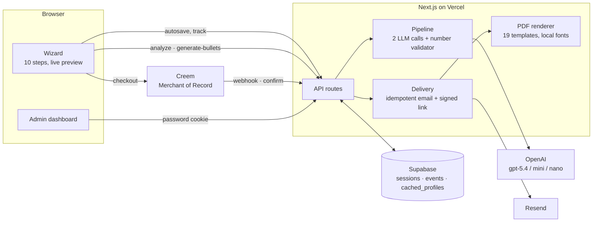
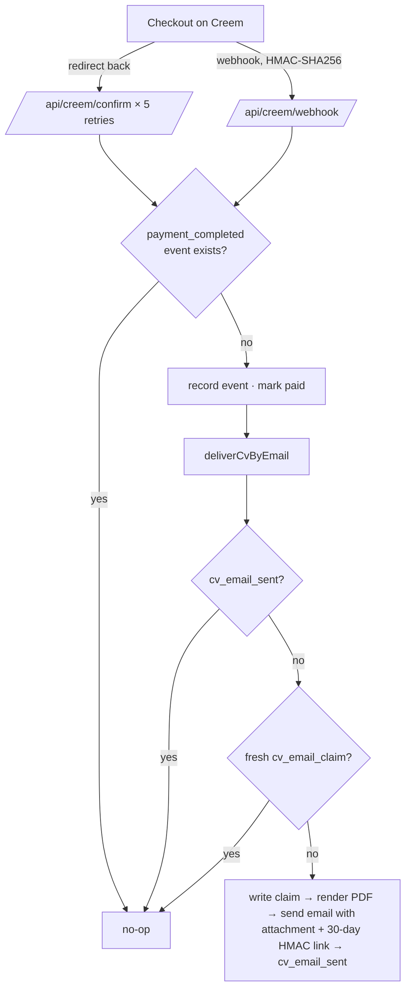

# Architecture

CVexpres is a single Next.js 16 application (App Router) deployed on Vercel. There is no separate backend: API routes run as serverless functions, data lives in Supabase (Postgres), AI calls go to OpenAI, PDFs are rendered server-side with `@react-pdf/renderer`, payments are handled by Creem as Merchant of Record, and delivery emails go through Resend.

## System overview



## The wizard

- `app/creare-cv/page.tsx` creates a session row and renders the client wizard.
- State is a `useReducer` (`hooks/use-wizard.ts`) with three persistence layers: localStorage (refresh-proof, 400 ms debounce), Supabase autosave (`PATCH /api/session/[id]`, 1 s debounce), and `step_reached` events for the admin funnel.
- Step order: contact → photo → target job → experience → education → skills → languages → licence → hobbies → finish. The live preview renders the chosen template as HTML, paginated to A4.
- Language: a `NEXT_LOCALE` cookie (`ro` default, `en` optional). Server components read it with `getLocale()`, client components with `useT()` / `useMessages()`. Stored CV values stay Romanian; only labels, prompts, PDF labels and emails switch.

## The AI pipeline

```mermaid
sequenceDiagram
  participant U as User
  participant S as /api/cv/*
  participant O as OpenAI
  participant V as validateBullets (code)
  U->>S: analyze(jobTitle, rawText, jobAd?)
  S->>O: call 1 — "the recruiter's eyes" (json_schema, strict)
  O-->>S: exactly 5 questions
  S-->>U: questions
  U->>S: generate-bullets(answers)
  S->>O: call 2 — "the CV writer"
  O-->>S: 7 bullets (nominal form)
  S->>V: every number must exist in rawText + answers
  alt invalid numbers
    S->>O: targeted regeneration (only the invalid bullets)
    O-->>S: corrected bullets
    S->>V: re-validate; drop what is still invalid
  end
  S-->>U: 5–7 validated bullets (else 422, retryable)
```

- Both calls use Structured Outputs (`response_format: json_schema`, `strict: true`) with one retry on invalid JSON, and an automatic retry without `reasoning_effort` when the API rejects it ([`lib/openai.ts`](../lib/openai.ts)).
- The validator ([`lib/cv-pipeline/stages.ts`](../lib/cv-pipeline/stages.ts)) is deterministic: `\d+(?:[.,]\d+)?` tokens in a bullet must appear in the source, with separator equivalences, Romanian word multipliers ("38 de mii" → 38000) and, in English, "38k" / "1.5 million" / "1,200".
- `generate-bullets` is idempotent: same answers + existing bullets → the saved result is returned.
- Secondary calls: job research (role → ideal profile, cached per role for 30 days), skills (no fallback by design), summary (best-effort), text correction (nano, with safety nets).
- Every call records an `ai_call` event with tokens, cost and duration; every caught route error records `api_error`.

## Payment and delivery



- Payments are a ledger in the `events` table. A read error throws instead of returning "not paid": a "don't know" treated as "no" would send duplicate emails.
- Promo codes go through the same path with a deterministic `transaction_id`.
- The re-download link is `<sessionId>.<expiryMs>.<hmac>`, verified with `timingSafeEqual`; no JWT.
- After payment the CV is frozen: `PATCH /api/session` returns 409, the PDF route renders only the stored snapshot.

## Data model

| Table | Role |
|---|---|
| `sessions` | one row per wizard session: `cv_data` (JSONB), status, template, timestamps |
| `events` | append-only log: `step_reached`, `payment_completed`, `cv_email_claim/sent`, `template_selected`, `contact_message`, `ai_call`, `api_error`, `validation_result` |
| `cached_profiles` | ideal-profile cache per normalised role (30-day TTL) |
| `cv_pipeline_sessions` | the two-call pipeline state (raw text, questions, answers, bullets, selection) |

The code tolerates un-migrated constraints (status values, template ids): fallbacks write to `events` so a deploy never depends on a manual migration step. Retention: sessions and their events are deleted 30 days after the last activity by a daily cron.

## Security and abuse controls

- Body size limits per route (2 MB CV data, 256 KB text, 4 KB tiny).
- Rate limiting per IP and bucket in Upstash Redis (`INCR` + `EXPIRE NX`), fail-open; in-memory fallback without Redis.
- Admin: password → sha256 token in an httpOnly, SameSite=strict cookie; 5 failed attempts per 15 minutes; no password fallback in code.
- Security headers: `X-Frame-Options: DENY`, `nosniff`, HSTS, `Permissions-Policy`.
- Secrets only in environment variables ([`.env.example`](../.env.example)).

## Observability

`/admin` (password) and `/demo/admin` (public, generated data) share one dashboard: per-session AI cost, calls, tokens, time, funnel per step, cost and latency (p50/p95) per AI stage, validation quality, errors per route, the model benchmark and a weekday × hour heatmap. Everything is anonymised server-side: the API never returns names or emails, only `Utilizator #xxxxxx`.
